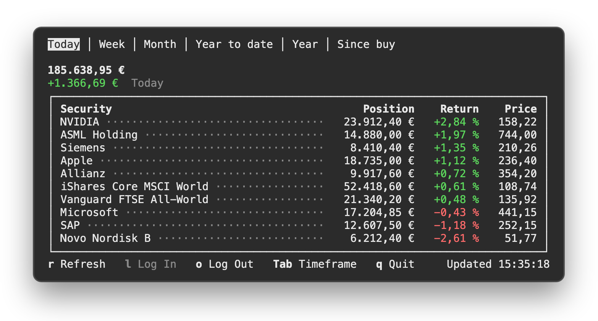
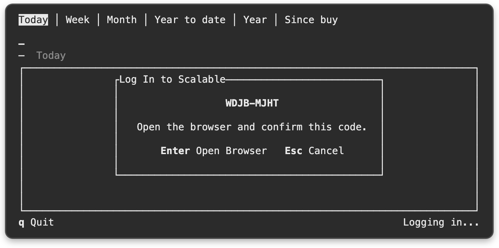

# scalable-embed

Unofficial Rust library for Scalable Capital, for use in other apps such as a
desktop app. It is a fork of [Scalable CLI](https://github.com/ScalableCapital/scalable-cli)
and is not affiliated with or supported by Scalable Capital. For the official
CLI, use the upstream releases.

The fork adds an embedding API with the CLI's login and session handling and
two ways to use them:

- **Read** with GraphQL queries of your own (`query`), fetching what a screen
  needs in one request.
- **Trade and make other changes** with CLI commands run in-process (`run`).
  They return the same JSON `data` that `sc <command> --json` prints and keep
  the CLI's behavior, including the two-step trade and savings-plan
  confirmation flows.

The terminal example is a small app built on the library. It shows a portfolio
and its holdings, and logs in from a dialog, here with made-up data:





## Usage

```toml
[dependencies]
scalable-embed = { git = "https://github.com/mlafeldt/scalable-embed" }
```

```rust
use std::sync::atomic::AtomicBool;
use scalable_embed::{Client, LoginEvent, Options};
use serde_json::json;

let mut client = Client::new(Options::new(app_config_dir, "com.example.myapp"))?;
if !client.is_logged_in()? {
    let cancel = AtomicBool::new(false);                   // set it to cancel
    client.login(&cancel, |event| {
        if let LoginEvent::DeviceCode(prompt) = event {
            show_code_and_open_browser(&prompt.user_code, prompt.url());
        }
    })?;
}

// Read: a query of your own.
let ids = client.broker_ids(None)?;
let data = client.query(
    "Total",
    "query Total($accountId: ID!, $portfolioId: ID!) {
       account(id: $accountId) {
         brokerPortfolio(id: $portfolioId) {
           valuation(includeYearToDate: false) { valuation }
         }
       }
     }",
    json!({"accountId": ids.account_id, "portfolioId": ids.portfolio_id}),
)?;

// Change: any sc command. This one only previews the order; repeating it
// with --confirm and the ID from the preview submits it.
let buy = ["broker", "trade", "buy", "--isin", "IE00B4L5Y983", "--amount", "100"];
let preview = client.run(buy)?;
```

A complete program lives in `embed/examples/terminal/`: a minimal terminal app
built with [ratatui](https://ratatui.rs). It shows the portfolio total, and its
change and the holdings ranked by their return over a timeframe picked with Tab.
It fetches all of it with one `query` at startup, every 10 seconds and on
refresh, and logs in from a dialog:

```bash
cd embed
cargo run --example terminal
```

Pass `--file-session` to keep the session in a file instead of the keychain.

`query` sends a GraphQL query of your own, with the session, request signing and
token refresh handled as for commands. `broker_ids` gives the account and
portfolio IDs most queries need, `query_as::<T>` deserializes the result into
your own serde type, and `decimal` and `Timeframe` help write that type. The
backend rate-limits requests (`RATE_LIMITED`), so fetch in one query what takes
several commands, such as per-holding returns, which `broker quote` fetches one
security at a time. Upstream's queries in `src/broker_queries.rs` show what the
API offers. Upstream doesn't maintain your queries, so an API change breaks them
without a failing test.

`run` runs any `sc` command except `login` and returns its raw JSON;
`run_as::<T>` deserializes it into your own serde type. Commands can read too,
but each is a request of its own, and upstream may change their JSON.

### Why reads and changes take different paths

The API would accept both as GraphQL. The library splits them because a mistake
costs differently on each side:

- **A wrong query shows a wrong number.** So reads are free-form. Upstream's
  read commands are shaped for the CLI's output: a screen that combines several
  of them needs several requests and soon hits the rate limit, where one query
  fetches exactly its fields.
- **A wrong mutation places a wrong order.** In the CLI an order is not one
  call but a preview with its checks and disclosures, a confirmation ID that
  expires, and only then the submit, within the trade controls you configure
  (allowed and denied ISINs, a maximum order amount). A mutation of your own
  would skip all of that, and you could only test it by placing orders. So
  `query` rejects mutations, and commands are the only way to change the
  account.

Upstream maintains the commands' order flow, so merging a release brings its
changes along. Nobody maintains your queries but you, which is acceptable for
reading and not for trading.

Errors carry the code `sc --json` reports, such as `no_session`, `rate_limited`
or `network_error`, so apps can match on `err.code()`; `err.needs_login()` tells
when only a new login helps.

- Use an app-specific `config_dir` and `keyring_service` so the app and the
  `sc` CLI never overwrite each other's session or signing key. The service
  also namespaces the Secure Enclave key when that backend is selected.
- Calls block. In async UIs, run them on a blocking thread; calling them
  directly inside an async runtime panics. The example gives the client its
  own thread and polls for replies.
- On macOS, every rebuild of an unsigned binary asks again for access to the
  session in the keychain. Pass `--file-session` to the example while
  developing to avoid that.
- The library authenticates as the official CLI (same OAuth client and API
  endpoint). Scalable can change or restrict these at any time.

## Security

Out of the box, this library is less secure than the official CLI. On macOS,
the official CLI keeps the key that signs every API request in the Secure
Enclave, where it cannot be copied off the device. This library stores that key
by default as a file readable only by your user account, in the app's
`config_dir`. The session token goes to the OS keychain, as with the official
CLI. Anything running as your user that can read both can use your Scalable
session.

To use the Secure Enclave instead, set
`options.config.auth.signing_key_backend = DpopKeyBackend::SecureEnclave`. It
fails in unsigned builds with OSStatus -34018 (missing keychain entitlement). An
app signed with keychain entitlements should work, but this is untested.

## Layout

The repository is upstream's code plus a few additions. The root package keeps
upstream's name, `scalable-cli`, so merging upstream releases doesn't conflict
in `Cargo.toml` or `Cargo.lock`. The `scalable-embed` crate in `embed/`
re-exports its `embed` module under the library's own name and holds what
needs none of upstream's code: the query helpers and the example, which can add
dependencies without touching the root `Cargo.lock`.

New code lives in `src/embed.rs`, `src/embed/`, `embed/` and `tests/embed.rs`.
This README and its screenshots live in `.github/`, so GitHub shows it instead
of upstream's `README.md`. Changes to upstream files are limited to these hooks:

| File | Change |
| --- | --- |
| `Cargo.toml` | `channel-prod` is a default feature (the public repo has no `build.rs` for the dev channel) |
| `src/lib.rs` | declares `pub mod embed` |
| `src/auth.rs` | device-code login split with a prompt callback; response fields and progress sink crate-visible for the embedding adapter |
| `src/config.rs` | config dir honors the embedder's override |
| `src/session.rs` | keyring service honors the embedder's override |
| `src/dpop/secure_enclave.rs` | two label overrides; namespace construction lives in `embed` |

`AGENTS.md` holds the rule that keeps it that way.

## Syncing with upstream

`main` is upstream's releases plus the fork's commits. Upstream publishes one
squashed commit per release, tagged `vX.Y.Z`; each sync merges that tag into
`main`. Merging rather than rebasing keeps fork commits stable for anyone who
depends on them.

```bash
git fetch upstream --tags
git merge vX.Y.Z
cargo test
```
