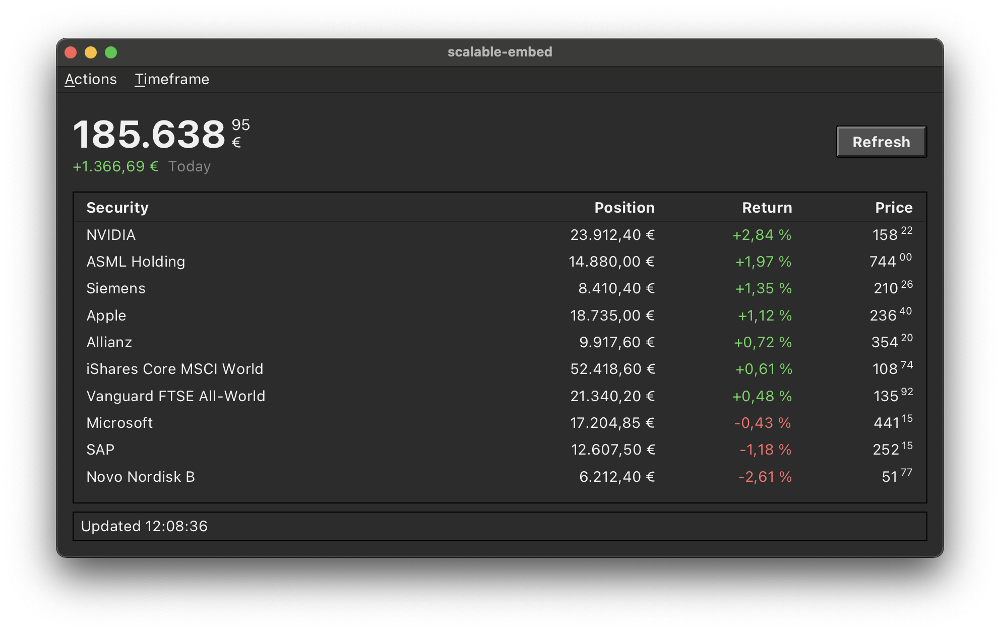

# scalable-embed

Unofficial Rust library for Scalable Capital, for use in other apps such as a
desktop app. It is a fork of [Scalable CLI](https://github.com/ScalableCapital/scalable-cli)
and is not affiliated with or supported by Scalable Capital. For the official
CLI, use the upstream releases.

The fork adds an embedding API that runs CLI commands in-process. Commands
return the same JSON `data` that `sc <command> --json` prints and keep the
CLI's behavior, including the two-step trade and savings-plan confirmation
flows.



*The [desktop example](#usage) with made-up data.*

## Security

Out of the box, this library is less secure than the official CLI. On macOS,
the official CLI keeps the key that signs every API request in the Secure
Enclave, where it cannot be copied off the device. This library stores that key
by default as a file readable only by your user account, in the app's
`config_dir`. The session token goes to the OS keychain, as with the official
CLI. Anything running as your user that can read both can use your Scalable
session.

To use the Secure Enclave instead, set
`options.config.auth.signing_key_backend = DpopKeyBackend::SecureEnclave`. It
fails in unsigned builds with OSStatus -34018 (missing keychain entitlement). An
app signed with keychain entitlements should work, but this is untested.

## Usage

```toml
[dependencies]
scalable-embed = { git = "https://github.com/mlafeldt/scalable-embed" }
```

```rust
use scalable_embed::{Client, Options};

let mut client = Client::new(Options::new(app_config_dir, "com.example.myapp"))?;
if !client.is_logged_in()? {
    client.login(|prompt| show_code_and_open_browser(prompt), &mut my_progress_ui)?;
}
let overview = client.broker_overview(None, false)?;     // typed
println!("{:?}", overview.result.valuation.total);
let txs = client.run(["broker", "transactions"])?;       // any sc command, raw JSON
```

Two complete programs live in `embed/examples/`. Both share their session and
files, and both take `--file-session` to keep the session in a file instead of
the keychain.

`terminal.rs` runs commands:

```bash
cd embed
cargo run --example terminal -- login
cargo run --example terminal -- overview
cargo run --example terminal -- logout
```

`desktop.rs` is a minimal desktop app built with
[saudade](https://github.com/roblillack/saudade). It shows the portfolio total,
and its change and the holdings ranked by their return over a timeframe picked
in the Timeframe menu. It fetches all of it in one `graphql` request at startup
and on Refresh (button or Cmd/Ctrl+R), and logs in from a dialog:

```bash
cd embed
cargo run --example desktop
```

Typed results (`src/embed/types.rs`) exist for `broker overview`, `broker
holdings` and `broker quote` so far; every other command is available through
`run` (raw JSON) or `run_as::<T>` with your own serde type. The typed structs ignore unknown fields
and treat values as optional, and their tests run upstream's real projection
code, so an upstream format change fails `cargo test` after merging an upstream
release.

`graphql` sends a query of your own, with the session, request signing and token
refresh handled as for commands. The backend rate-limits requests
(`RATE_LIMITED`), so use it to fetch in one request what takes several
commands, such as per-holding returns, which `broker quote` fetches one security
at a time. Upstream doesn't maintain these queries, so an API change breaks them
without a failing test.

- Use an app-specific `config_dir` and `keyring_service` so the app and the
  `sc` CLI never overwrite each other's session.
- Calls block. In async UIs, run them on a blocking thread; calling them
  directly inside an async runtime panics. The desktop example gives the client
  its own thread and polls for replies.
- On macOS, every rebuild of an unsigned binary asks again for access to the
  session in the keychain. Pass `--file-session` to the examples while
  developing to avoid that.
- The library authenticates as the official CLI (same OAuth client and API
  endpoint). Scalable can change or restrict these at any time.

## Layout

The repository is upstream's code plus a few additions. The root package keeps
upstream's name, `scalable-cli`, so merging upstream releases doesn't conflict
in `Cargo.toml` or `Cargo.lock`. The `scalable-embed` crate in `embed/`
re-exports its `embed` module under the library's own name and holds the
examples, which can add dependencies without touching the root `Cargo.lock`.

New code lives in `src/embed.rs`, `src/embed/`, `embed/` and `tests/embed.rs`.
This README and its screenshots live in `.github/`, so GitHub shows it instead
of upstream's `README.md`. Changes to upstream files are limited to these hooks:

| File | Change |
| --- | --- |
| `Cargo.toml` | `channel-prod` is a default feature (the public repo has no `build.rs` for the dev channel) |
| `src/lib.rs` | declares `pub mod embed` |
| `src/auth.rs` | device-code login split so the prompt and progress can go to caller hooks; `DeviceCodePrompt` and `LoginProgressSink` are public |
| `src/config.rs` | config dir honors the embedder's override |
| `src/session.rs` | keyring service honors the embedder's override |

Keep it that way: change upstream files only in these hooks, add no
dependencies (keeps `Cargo.lock` conflict-free), and don't reformat upstream
code.

## Syncing with upstream

`main` is upstream's releases plus the fork's commits. Upstream publishes one
squashed commit per release, tagged `vX.Y.Z`; each sync merges that tag into
`main`. Merging rather than rebasing keeps fork commits stable for anyone who
depends on them.

```bash
git fetch upstream --tags
git merge vX.Y.Z
cargo test
```
